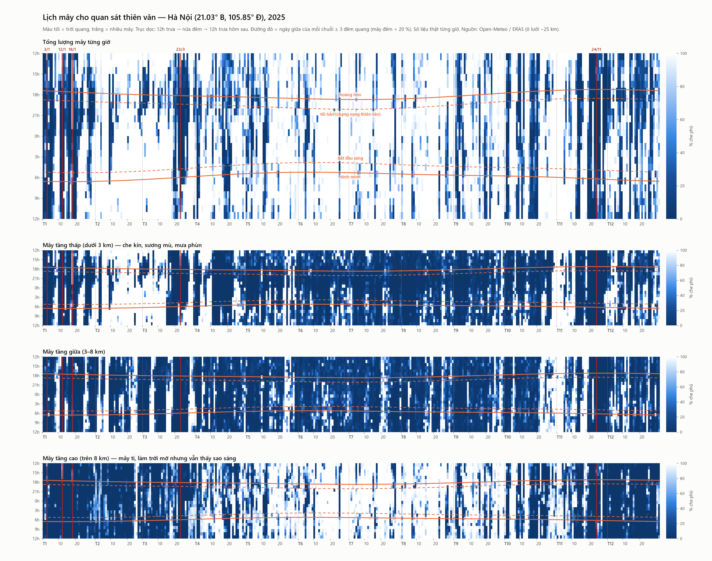

# Hanoi Stargazing — Lịch mây cho quan sát thiên văn

Mỗi năm một tờ "lịch mây". Nhìn vào là biết **đêm nào trời quang** ở Hà Nội. Ảnh dùng số liệu thật từng giờ, tách riêng mây tầng thấp, tầng giữa và tầng cao.



## Cách đọc

- **Trục ngang:** 365 ngày trong năm. Vạch đậm là ngày 1 của tháng, vạch nhạt là ngày 10 và 20.
- **Trục dọc:** từ 12h trưa, qua nửa đêm, đến 12h trưa hôm sau. Cả đêm quan sát nằm liền một khối ở giữa hình.
- **Màu:** xanh đậm là trời quang, trắng là nhiều mây.
- **Đường cam liền:** hoàng hôn và bình minh.
- **Đường cam đứt:** chạng vạng thiên văn, lúc mặt trời thấp hơn 18° dưới chân trời. Khoảng nằm giữa hai đường đứt là lúc trời tối hẳn.
- **Đường đỏ:** ngày giữa của mỗi chuỗi **từ 3 đêm quang trở lên**, có thể xen 1 đêm xấu. Đêm quang là đêm có mây trung bình lúc tối hẳn dưới 20 %.
- **4 khung:**
  - Tổng lượng mây.
  - Mây tầng thấp (dưới 3 km): che kín trời, sương mù, mưa phùn.
  - Mây tầng giữa (3–8 km).
  - Mây tầng cao (trên 8 km): mây ti, làm trời mờ nhưng vẫn thấy được sao sáng.

## Ngày giữa các vùng đêm quang ở Hà Nội

| Năm | Ngày giữa vùng đêm quang | Ảnh |
|---|---|---|
| 2016 | 7/2, 12/2, 14/4, 6/5, 1/6, 7/10, 4/11, 7/12 | [xem](images/ha-noi/lich-may-ha-noi-2016.png) |
| 2017 | 28/1, 8/4, 1/5, 31/10, 18/12 | [xem](images/ha-noi/lich-may-ha-noi-2017.png) |
| 2018 | 11/4, 16/5, 24/9, 3/10, 31/10, 24/11, 17/12 | [xem](images/ha-noi/lich-may-ha-noi-2018.png) |
| 2019 | 9/4, 21/4, 18/5, 6/9, 27/9, 19/10, 6/12 | [xem](images/ha-noi/lich-may-ha-noi-2019.png) |
| 2020 | 9/10, 6/12 | [xem](images/ha-noi/lich-may-ha-noi-2020.png) |
| 2021 | 12/2, 13/7, 5/12 | [xem](images/ha-noi/lich-may-ha-noi-2021.png) |
| 2022 | 24/2, 6/4, 25/4, 24/7, 11/10, 6/11, 13/12 | [xem](images/ha-noi/lich-may-ha-noi-2022.png) |
| 2023 | 19/1, 29/1, 1/3, 20/4, 3/5, 19/5, 9/11, 19/11, 26/12 | [xem](images/ha-noi/lich-may-ha-noi-2023.png) |
| 2024 | 1/4, 27/4, 5/8, 14/11, 29/12 | [xem](images/ha-noi/lich-may-ha-noi-2024.png) |
| 2025 | 3/1, 12/1, 18/1, 23/3, 24/11 | [xem](images/ha-noi/lich-may-ha-noi-2025.png) |

**Nhận xét chung:**
- Các đợt đêm quang tập trung vào **tháng 4–5** và **tháng 10–12**.
- **Tháng 2 đến tháng 3** thường bị mây tầng thấp phủ kín (mùa nồm, mưa phùn).
- **Mùa hè** hiếm có đêm quang, chủ yếu vì mây ti tầng cao phủ suốt đêm.

## Tự chạy

Cần Python 3 và 3 thư viện `numpy`, `matplotlib`, `requests`.

```
pip install -r requirements.txt

python bieu_do_may.py                          # Hà Nội, 2025
python bieu_do_may.py --tu 2016 --den 2025     # mỗi năm 1 ảnh
python bieu_do_may.py --lat 21.08 --lon 105.37 --ten "Ba Vì" --tu 2024
```

- Ảnh được lưu vào `images/<địa điểm>/`.
- Dữ liệu tải về được lưu đệm trong `data-cache/` (không đưa lên git), nên lần sau vẽ lại không cần tải.
- Ô lưới dữ liệu rộng khoảng 25 km, nên các quận nội thành Hà Nội cho cùng một kết quả. Chỉ những nơi ở xa như Ba Vì hay Sóc Sơn mới cần chạy riêng bằng `--lat` và `--lon`.

## Nguồn dữ liệu và giới hạn

- **Nguồn:** dữ liệu thời tiết lấy từ [Open-Meteo](https://open-meteo.com/) Historical Weather API, theo giấy phép [CC BY 4.0](https://creativecommons.org/licenses/by/4.0/).
- **Dữ liệu gốc:** tái phân tích ERA5 của ECMWF / Copernicus Climate Change Service.
- **Giới hạn:** ERA5 là số liệu **mô hình đồng hóa**, không phải quan trắc tại chỗ. Với ô lưới khoảng 25 km, dữ liệu không thể hiện được hiệu ứng cục bộ như sương thung lũng hay khói bụi đô thị.
- **Giờ mặt trời:** tính bằng công thức gần đúng của NOAA, sai số vài phút.

## Giấy phép

- **Code:** giấy phép [MIT](LICENSE).
- **Ảnh:** chứa dữ liệu Open-Meteo / ERA5, nên khi dùng lại cần ghi nguồn theo CC BY 4.0 như mục trên.
